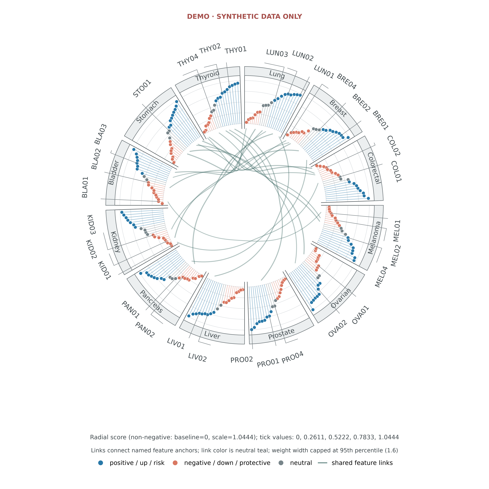

# FigStudio

Scientific Figure Studio for high-impact biomedical and bioinformatics figures.

FigStudio integrates evidence-first figure planning, 129 plot recipes, AI-assisted mechanism schematic prompts, journal-ready export, and high-impact visual QC for Nature/Cell/Science-style workflows.

## Included

- 129 registered plot recipes, including a data-driven `circos_lollipop_chord` composite.
- Vector-first PDF/SVG export plus RGB PNG/TIFF export with journal-oriented DPI checks.
- Pale accessible palettes, explicit figure contracts, source-data traceability, and claim-boundary review.
- AI image-generation guidance for text-free conceptual source assets; AI assets are never treated as quantitative evidence.

## Quick start

```bash
python scripts/figure_studio.py catalog
python scripts/figure_studio.py render --kind volcano_plot --out figure --seed 7
python scripts/figure_studio.py render --kind circos_lollipop_chord --features examples/circos_v2/features.csv --links examples/circos_v2/links.csv --sectors examples/circos_v2/sectors.csv --data-status demo --top-k 4 --width-mm 180 --formats pdf,svg,png --out results/circos_v2
python scripts/figure_studio.py contact-sheet --out catalog_preview --limit 129
python scripts/qc_figures.py path/to/figures --output audit/figure_qc.tsv --json audit/figure_qc.json
```

Install the Python dependencies when needed:

```bash
python -m pip install -r requirements.txt
```

The governing workflow is documented in [`SKILL.md`](SKILL.md).

The Circos example tables are synthetic test data only. They do not represent biological findings. The V2 recipe contract and link interpretation are documented in [`references/plot-catalog.md`](references/plot-catalog.md). Each render writes PDF/SVG/600 dpi PNG, normalized input snapshots, configuration, manifest, label-suppression table, and a QC report.



[Target / failed V1 / rebuilt V2 visual comparison](gallery/circos_v2_comparison.png)
